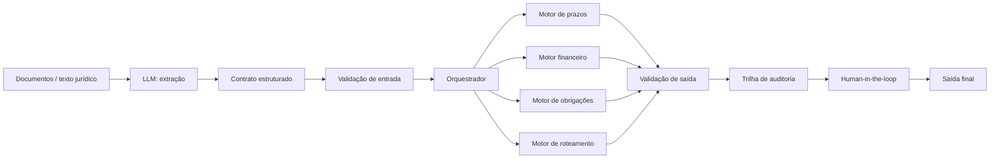
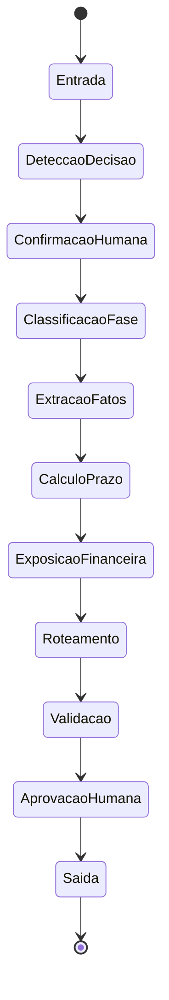

<p align="center">
  
</p>

<p align="center">
  <a href="https://github.com/khaosfelix/legal-ai-recursal-workflow/actions/workflows/ci.yml">
    
  </a>
  
  
  
  
</p>

# Legal AI Recursal Workflow

Automação jurídica híbrida para **análise estruturada de decisões, cálculo de prazos e exposição financeira, roteamento recursal e geração de saídas auditáveis**.

Este repositório é uma versão pública, sintética e redesenhada para portfólio de uma arquitetura de automação jurídica. O foco não é “pedir para uma LLM decidir tudo”: o projeto separa interpretação de texto, regras de negócio, cálculos e validações em camadas distintas.

> **Ideia central:** usar IA onde existe ambiguidade textual e usar código determinístico onde erro não deveria depender de probabilidade.

---

## Em 30 segundos

O workflow recebe um caso estruturado, valida os dados, calcula prazo de Embargos de Declaração, apura exposição financeira com `Decimal`, separa compensações do total bruto, identifica gatilhos recursais fictícios, trata decisões anuladas e devolve uma saída com **rota, registro, alertas e trilha de auditoria**.

A camada pública é **LLM-agnostic**: o contrato de extração está documentado, mas nenhuma chave, provedor ou API privada é necessária para executar o demo.

```text
documentos
   ↓
extração estruturada por LLM
   ↓
contrato de dados
   ↓
validação
   ↓
motor determinístico
   ├── prazos
   ├── financeiro
   ├── obrigações
   └── roteamento
   ↓
trilha de auditoria
   ↓
validação humana
```

---

## O problema que o projeto resolve

Em contencioso de alto volume, uma análise operacional pode exigir simultaneamente:

- localizar e classificar a decisão relevante;
- transformar texto jurídico em campos estruturados;
- calcular prazos em dias úteis;
- distinguir valor exato de estimativa;
- calcular honorários e exposição financeira;
- manter compensações rastreáveis sem distorcer o valor bruto;
- identificar obrigações de fazer de forma operacional;
- reconhecer gatilhos para revisão recursal;
- tratar decisões anuladas sem carregar efeitos da decisão anterior;
- padronizar saídas;
- impedir que mudanças no prompt quebrem regras já validadas.

O desafio, portanto, não é apenas gerar texto. É **orquestrar interpretação, regras, cálculos, governança e revisão humana**.

---

## Funcionalidades

| Módulo | O que demonstra | Abordagem |
|---|---|---|
| Classificação decisória | Sentença, acórdão e cumprimento | Domínio tipado com `Enum` |
| Prazo de ED | 5 dias úteis no cenário sintético | Motor determinístico |
| Status do prazo | Aberto, ultrapassado ou ED apresentado | Regra auditável |
| Danos materiais | Valor exato ou fallback estimado | Fonte do valor registrada |
| Honorários | Percentual ou valor fixo | `Decimal`, sem `float` |
| Exposição financeira | Soma bruta das verbas efetivas | Compensação separada |
| Obrigação de fazer | Ação + objeto + identificador + local | Formatação operacional |
| Roteamento | Revisão recursal, não recurso, retorno à origem ou revisão humana | Rule engine |
| Decisão anulada | Limpa exposição/OBF anterior | Gate específico |
| Prazo pós-retorno | Regra operacional sintética | Dias úteis |
| Validação | Campos, datas, valores e consistência | Fail fast |
| Auditoria | Motivos de cada etapa | Trilha textual |
| Privacidade | Casos sintéticos + scanner de publicação | Privacy by design |
| Qualidade | Testes unitários e CI | GitHub Actions |

---

## Arquitetura



### Máquina de estados conceitual



---

## Decisões de engenharia

### 1. `Decimal` para dinheiro

Valores monetários não são calculados com `float`. O módulo financeiro usa `Decimal` e arredondamento explícito.

### 2. LLM não calcula o que o código pode calcular

A LLM é tratada como camada de **extração e interpretação**, não como calculadora de prazos ou exposição.

### 3. Regras de domínio são explícitas

Critérios recursais do demo são fictícios e ficam isolados no módulo de roteamento. Isso evita esconder regras importantes dentro de um prompt gigante.

### 4. Saída explica o próprio caminho

Além do resultado, o motor registra uma **trilha de auditoria**: prazo calculado, fonte do dano material, base de honorários, rota aplicada e alertas.

### 5. Falha cedo

Valores negativos, datas incoerentes e campos incompatíveis falham antes da análise final.

### 6. Human-in-the-loop é requisito, não decoração

O sistema produz apoio à decisão. A aprovação final é humana.

---

## Demo rápida

Não há dependências externas de runtime.

### Windows / PowerShell

```powershell
python scripts/demo.py synthetic_cases/caso_01_sentenca.json
```

### Linux / macOS

```bash
python3 scripts/demo.py synthetic_cases/caso_01_sentenca.json
```

### Saída esperada

```text
CASO: DEMO-001
DECISÃO: PARCIALMENTE PROCEDENTE
PRAZO ED: 10/11/2026 — ABERTO
DANO MATERIAL: R$ 1.200,00 — VALOR_EXATO
HONORÁRIOS: R$ 620,00
COMPENSAÇÃO: R$ 800,00 — informada separadamente
EXPOSIÇÃO BRUTA: R$ 6.820,00
ROTA: REVISÃO RECURSAL RECOMENDADA
REGISTRO: REGISTRO_DECISÃO_1_GRAU
OBRIGAÇÃO: Cancelar a cesta de serviços identificada como DEMO-PACOTE na conta fictícia da parte autora.
```

---

## Testes

```bash
python -m unittest discover -s tests -v
```

A suíte cobre, entre outros:

- contagem em dias úteis;
- feriados fornecidos ao motor;
- prazo aberto e ultrapassado;
- preferência por dano material exato;
- fallback para estimativa;
- honorários percentuais e fixos;
- compensação fora do total bruto;
- prioridade de decisão anulada;
- gatilho de não recurso em acórdão;
- obrigação operacional;
- validação de valores negativos;
- fluxo completo de retorno à origem.

O CI também executa uma **verificação de publicação**, procurando padrões de segredo e dados potencialmente inadequados para um repositório público.

---

## Estrutura do projeto

```text
legal-ai-recursal-workflow/
├── src/
│   └── legal_ai_recursal/
│       ├── calendario.py
│       ├── engine.py
│       ├── enums.py
│       ├── financeiro.py
│       ├── formatacao.py
│       ├── models.py
│       ├── obrigacoes.py
│       ├── roteamento.py
│       └── validacao.py
├── prompts/
│   ├── prompt_extracao.md
│   └── system_prompt_demo.md
├── knowledge_demo/
│   ├── regras_publicas.md
│   └── templates_saida.md
├── schemas/
│   ├── analise_saida.schema.json
│   └── caso_entrada.schema.json
├── synthetic_cases/
│   ├── caso_01_sentenca.json
│   ├── caso_02_acordao_prazo_ultrapassado.json
│   ├── caso_03_acordao_anulado.json
│   ├── caso_04_estimativa_material.json
│   └── caso_05_cumprimento.json
├── examples/
├── tests/
├── scripts/
│   ├── demo.py
│   └── verificar_publicacao.py
└── docs/
    ├── ARQUITETURA.md
    ├── DECISOES_DE_DESIGN.md
    ├── MAPA_DE_FUNCIONALIDADES.md
    ├── PRIVACIDADE.md
    ├── ROADMAP.md
    └── COMO_APRESENTAR_EM_ENTREVISTA.md
```

---

## Camada de IA

Este repositório não fixa OpenAI, Anthropic, Gemini ou outro provedor.

O contrato de extração está em [`prompts/prompt_extracao.md`](prompts/prompt_extracao.md) e [`schemas/caso_entrada.schema.json`](schemas/caso_entrada.schema.json).

Em uma integração real, o fluxo seria:

```text
PDF / DOCX / API
      ↓
LLM / parser
      ↓
JSON validado
      ↓
Legal AI Recursal Engine
```

Essa separação permite trocar o modelo sem reescrever as regras determinísticas.

---

## Privacidade e confidencialidade

O repositório foi desenhado para ser público.

Ele **não contém**:

- nomes de clientes;
- nomes de escritórios;
- processos reais;
- contratos reais;
- documentos internos;
- políticas empresariais;
- códigos de sistemas privados;
- screenshots corporativos;
- credenciais;
- endpoints privados.

Todos os dados, regras e casos são sintéticos.

A estratégia completa está em [`docs/PRIVACIDADE.md`](docs/PRIVACIDADE.md).

---

## O que este projeto demonstra para recrutamento

**Legal Ops / Legal Engineering**
- modelagem de fluxo jurídico;
- transformação de procedimento em regras;
- padronização operacional;
- controles de risco e revisão.

**Automação e IA**
- separação LLM × deterministic engine;
- contratos de dados;
- prompt design;
- arquitetura modular;
- integração model-agnostic.

**Engenharia**
- tipagem de domínio;
- cálculos monetários com `Decimal`;
- validações;
- testes de regressão;
- CI;
- trilha de auditoria;
- privacy by design.

---

## Limitações conscientes

Este é um **case de portfólio**, não um sistema jurídico de produção.

- O calendário não consulta automaticamente tribunais ou feriados oficiais.
- Os critérios recursais são fictícios.
- A camada pública recebe JSON normalizado; a chamada real ao provedor de LLM não está incluída.
- Não há persistência, autenticação ou interface web.
- Nenhuma saída substitui revisão jurídica humana.

Essas limitações são intencionais: o objetivo é demonstrar arquitetura e método sem reproduzir qualquer processo corporativo privado.

---

## Roadmap

- [ ] adapter de LLM com structured outputs;
- [ ] camada RAG com fontes públicas;
- [ ] API FastAPI;
- [ ] persistência de auditoria;
- [ ] dashboard de análise;
- [ ] exportação DOCX;
- [ ] calendário oficial plugável por tribunal;
- [ ] métricas de qualidade e benchmark sintético.

Veja [`docs/ROADMAP.md`](docs/ROADMAP.md).

---

## Autoria

Projeto de portfólio de [@khaosfelix](https://github.com/khaosfelix), com foco em **Legal AI, automação jurídica e Legal Ops**.

A versão pública foi redesenhada com dados e regras sintéticos para demonstrar a arquitetura sem expor informações confidenciais.
