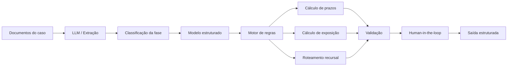

# Legal AI Recursal Workflow

> Portfólio demonstrativo de automação jurídica com IA para análise de decisões, triagem recursal, cálculo de prazos e geração de saídas estruturadas.

Este repositório apresenta uma **versão pública e inteiramente sintética** de uma arquitetura desenvolvida para automatizar fluxos jurídicos repetitivos de contencioso de alto volume.

O projeto demonstra como combinar:
- LLM para leitura e extração de informações;
- regras determinísticas para decisões críticas;
- máquina de estados para controlar o fluxo;
- cálculo de prazos e exposição financeira;
- validações anti-hallucination;
- human-in-the-loop;
- geração de saídas estruturadas;
- testes de regressão.

**Nenhum dado de cliente, processo real, política interna, manual corporativo, código de sistema ou documento confidencial está presente neste repositório.** Todas as pessoas, valores, regras e casos são fictícios.

## Problema

Fluxos jurídicos de alto volume exigem identificar a decisão relevante, diferenciar fases, extrair condenações e obrigações, calcular prazos, estimar exposição, escolher o fluxo correto e gerar uma saída padronizada. Parte disso depende de interpretação; outra parte deve ser **determinística e auditável**.

A arquitetura separa essas duas camadas.

## Arquitetura



## Máquina de estados

```text
INPUT
  ↓
DECISION_DETECTION
  ↓
HUMAN_CONFIRMATION
  ↓
PHASE_CLASSIFICATION
  ↓
FACT_EXTRACTION
  ↓
DEADLINE_ENGINE
  ↓
FINANCIAL_EXPOSURE
  ↓
APPEAL_RULE_ENGINE
  ↓
OUTPUT_VALIDATION
  ↓
HUMAN_APPROVAL
  ↓
FINAL_OUTPUT
```

## Funcionalidades demonstradas

- classificação de decisão;
- normalização do resultado decisório;
- cálculo de prazo de Embargos de Declaração em dias úteis;
- detecção de prazo ultrapassado;
- cálculo de valor total de exposição;
- separação entre compensação e valor bruto;
- geração de obrigação operacional;
- roteamento entre recurso e justificativa de não recurso;
- tratamento de decisão anulada com retorno à origem;
- validação de campos obrigatórios;
- testes automatizados.

## Estrutura

```text
legal-ai-recursal-workflow/
├── README.md
├── ARCHITECTURE.md
├── PRIVACY.md
├── DISCLAIMER.md
├── NOTICE.md
├── src/
├── prompts/
├── knowledge_demo/
├── schemas/
├── synthetic_cases/
├── examples/
├── tests/
└── docs/
```

## Rodando o demo

Requer Python 3.10+ e não usa bibliotecas externas.

```bash
python -m src.cli synthetic_cases/case_01_sentence.json
```

Testes:

```bash
python -m unittest discover -s tests -v
```

## Exemplo de entrada

```json
{
  "case_id": "DEMO-001",
  "phase": "sentence",
  "decision_result": "partially_granted",
  "notification_date": "2026-11-03",
  "current_date": "2026-11-06",
  "moral_damages": 5000.0,
  "material_damages": 1200.0,
  "fee_percentage": 10,
  "compensation": 800.0,
  "appeal_criteria": ["compensation_issue"]
}
```

## Exemplo de saída

```text
Decisão: PARCIALMENTE PROCEDENTE
Prazo ED: 10/11/2026
Danos morais: R$ 5.000,00
Danos materiais: R$ 1.200,00
Honorários: R$ 620,00
Compensação: R$ 800,00 — informada separadamente
Valor total bruto: R$ 6.820,00
Roteamento: REVISÃO RECURSAL RECOMENDADA
```

## O que este projeto demonstra

- Prompt orchestration
- RAG / Knowledge Design
- Rule Engine
- Structured Outputs
- Deterministic Calculations
- State Machines
- Human Validation Gates
- Regression Testing
- Privacy by Design

## Limites

Este repositório é um demonstrador educacional e de portfólio. Não substitui análise jurídica profissional, não reproduz políticas de qualquer empresa e não deve ser usado como regra processual oficial.

Veja também [PRIVACY.md](PRIVACY.md) e [DISCLAIMER.md](DISCLAIMER.md).
