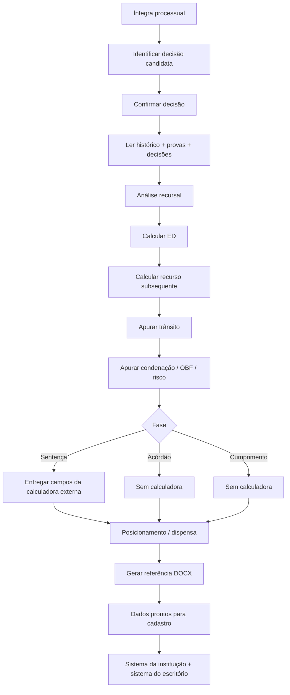
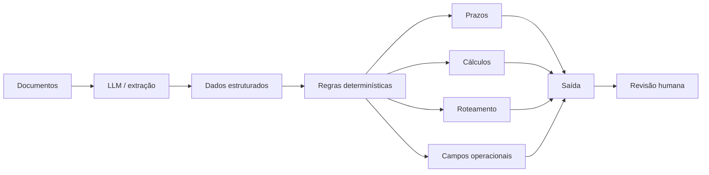

<p align="center">
  
</p>

<p align="center">
  <a href="https://github.com/khaosfelix/legal-ai-recursal-workflow/actions/workflows/ci.yml">
    
  </a>
  
  
</p>

# Legal AI Recursal Workflow

Este projeto nasceu de uma rotina de análise recursal em **contencioso cível massificado de instituição financeira**.

O volume não tornava o trabalho simples. Cada decisão precisava ser lida dentro do histórico do processo, comparada com o que havia sido pedido, defendido e provado, e depois convertida em uma série de providências operacionais: prazo de ED, recurso subsequente, trânsito em julgado, exposição financeira, obrigação de fazer, posicionamento recursal e dados para cadastro.

Além disso, a operação já utilizava ferramentas próprias da instituição e do escritório. A automação não foi criada para substituir essas ferramentas. Ela foi criada para **chegar até elas com a análise pronta**.

Um exemplo importante é a calculadora recursal: ela é uma ferramenta externa da instituição financeira. Em sentenças elegíveis, a automação analisa o caso e devolve os campos necessários para preenchê-la. Em acórdãos e decisões de cumprimento, essa etapa não existe.

A versão deste repositório é pública e usa apenas dados sintéticos. Mantive o desenho do fluxo e os problemas que precisei resolver, mas não publiquei nomes de clientes, sistemas, documentos, códigos de cadastro, políticas internas ou regras privadas.

---

## O fluxo que eu automatizei



A revisão humana continua no fluxo. O objetivo é reduzir leitura repetitiva, cálculo manual e retrabalho de cadastro — não eliminar o advogado da decisão.

---

## 1. Leitura da íntegra processual

A análise foi pensada para cruzar, quando disponíveis:

- petição inicial;
- documentos da parte autora;
- contestação;
- subsídios;
- réplica;
- contratos;
- logs e registros de autenticação;
- extratos;
- comprovantes de crédito;
- estornos e movimentações;
- tutelas;
- sentença;
- Embargos de Declaração;
- recursos;
- contrarrazões;
- acórdãos;
- decisões em cumprimento/execução.

Um ponto importante do fluxo é separar **alegação, prova e conclusão judicial**. Isso evita tratar como fato algo que apareceu apenas na narrativa de uma das partes.

Na versão pública, essa etapa é representada por um contrato JSON já normalizado, para que o core possa ser testado sem depender de uma API de LLM.

---

## 2. Análise recursal

A automação não olha só para o dispositivo.

Ela organiza, conforme o caso:

- pedidos e controvérsia;
- prescrição;
- contratação e subsídios;
- suficiência de prova;
- crédito e movimentação;
- proveito econômico;
- compensação;
- estornos;
- repetição;
- danos materiais e morais;
- honorários;
- custas;
- índices e juros;
- obrigação de fazer;
- risco;
- possíveis vícios para ED;
- matéria para recurso subsequente.

Em produtos financeiros, por exemplo, o fluxo diferencia **crédito lançado em conta** de **proveito econômico efetivo**. Dependendo do caso, isso exige olhar o que aconteceu depois do crédito: saque, transferência, movimentação, estorno ou recomposição.

---

## 3. ED, recurso subsequente e trânsito em julgado

Esses três pontos fazem parte do mesmo bloco operacional.

### Embargos de Declaração

O motor calcula e classifica o prazo como:

- `ABERTO`;
- `ULTRAPASSADO`;
- `APRESENTADO`;
- `AGUARDANDO_EVENTO`.

### Recurso subsequente

A perda do prazo de ED não encerra automaticamente a análise.

Antes de concluir que não haverá recurso, o fluxo verifica se existe um recurso subsequente candidato e calcula seu prazo.

Isso é relevante porque, na operação que originou o projeto, o prazo e a conclusão recursal precisavam ser cadastrados quando o caso seguia sem recurso.

### Trânsito em julgado

O fluxo diferencia:

- `CERTIFICADO`: existe data expressa;
- `ESTIMADO`: todos os prazos configurados encerraram sem recurso pendente;
- `NÃO APURADO`: ainda existe prazo, recurso ou evento processual em aberto.

Uma estimativa nunca é apresentada como certidão.

A saída também pode fornecer a data já formatada para copiar no cadastro.

---

## 4. Posicionamento recursal

Quando existe matéria para revisão, a entrega não é apenas “recorrer”.

O posicionamento pode organizar:

- instrumento candidato;
- objetivo da reforma;
- teses prioritárias;
- ponto da decisão a atacar;
- documentos e provas relevantes;
- riscos;
- pedidos subsidiários;
- possível benefício econômico.

A finalidade é acelerar a análise e já deixar um roteiro objetivo para quem vai elaborar a peça.

Quando não há fundamento ou utilidade recursal, o fluxo também pode gerar uma justificativa de não interposição para o cadastro operacional.

---

## 5. Calculadora recursal externa

Esta é uma distinção importante do projeto:

**eu não construí a calculadora recursal.**

Ela já existia como ferramenta da instituição financeira.

O que eu automatizei foi a análise anterior ao preenchimento.

Em **sentenças elegíveis**, o workflow entrega um bloco com os dados processuais, jurídicos e financeiros necessários para preencher a ferramenta externa.

Exemplo público e simplificado:

```text
CALCULADORA EXTERNA — CAMPOS PARA PREENCHIMENTO

Fase: SENTENÇA
Tipo de procedimento: DEMO
Liquidez: LÍQUIDA
UF: XX
Identificador do processo: DEMO0001
Critérios jurídicos identificados:
- questão de compensação

Dano moral: R$ 5.000,00
Dano material: R$ 1.200,00
Total moral + material: R$ 6.200,00
```

Em **acórdão** e **cumprimento/execução**, o bloco não é gerado.

No código isso é tratado explicitamente, e há teste garantindo que a calculadora externa só apareça em sentença.

---

## 6. Condenação e exposição

A automação tenta evitar saídas vagas como `a apurar` quando existe base documental para chegar a um número ou a uma estimativa operacional.

O motor público diferencia:

- valor material exato;
- estimativa;
- honorários;
- outras verbas;
- compensação;
- exposição bruta.

Exemplo:

```text
danos morais
+ danos materiais
+ honorários
+ demais verbas efetivas
= exposição bruta
```

A compensação é registrada separadamente para não esconder o valor bruto.

---

## 7. Obrigação de fazer

A obrigação é convertida em instrução operacional.

Em vez de:

```text
cessar cobrança
```

a saída busca algo como:

```text
Cancelar a cesta de serviços identificada como DEMO-PACOTE na conta fictícia da parte autora.
```

A mesma lógica vale para contrato, operação, anotação ou outro objeto identificável.

---

## 8. Cumprimento e execução

Decisões em cumprimento têm fluxo próprio.

O projeto público demonstra:

- valor devido;
- valor já pago ou garantido;
- diferença;
- complemento;
- distinção entre pagamento e garantia;
- justificativa operacional.

Essa fase não gera campos para a calculadora recursal externa.

---

## 9. Acórdão que anula/cassa a sentença

Quando a sentença deixa de produzir efeitos por causa do acórdão, o fluxo não reaproveita automaticamente a condenação anterior.

A automação:

- zera a exposição que dependia da sentença anulada;
- remove a obrigação de fazer anterior;
- muda a rota para retorno à origem;
- apura o trânsito;
- calcula o próximo prazo operacional, quando possível;
- diferencia cenário com contestação já apresentada e cenário sem contestação.

---

## 10. Referência DOCX e cadastro

Uma parte importante da automação é transformar a análise em um artefato operacional.

O workflow gera uma **referência em DOCX** com os campos estruturados da decisão.

Esse arquivo era utilizado para facilitar o cadastro e acompanhar o arquivo da própria decisão em dois pontos da operação:

- sistema jurídico da instituição financeira;
- sistema do escritório.

Além do DOCX, a saída em chat entrega os campos que precisam ser copiados para cadastro, como:

- data da intimação;
- prazo de ED;
- prazo do recurso subsequente;
- data/fonte do trânsito;
- risco;
- existência de obrigação;
- tipo de providência;
- justificativa de não recurso, quando cabível.

Na versão pública, o DOCX é gerado por um renderer simples e sintético.

---

## 11. Outras rotinas que fazem parte da análise

Nem tudo precisa virar um módulo público para fazer parte do fluxo. A automação original também consolidava ou conferia:

- classificação e eventual agravamento de risco, sem fingir alteração no sistema externo;
- custo recursal em separado da condenação;
- índices e juros, mantendo a análise jurídica completa e uma saída operacional mais curta;
- obrigação de fazer existente em decisão anterior ainda vigente, mesmo quando a decisão atual fosse silenciosa;
- existência de acordo ou outra informação operacional externa como metadado do caso;
- tipo de registro interno adequado à fase, instância e resultado;
- justificativa de não interposição;
- mensagem curta com identificação do caso, decisão, prazo e providência;
- conferência final para evitar saída sem prazo, OBF, condenação ou providência quando esses dados eram aplicáveis.

Essas rotinas estão descritas com mais detalhe em [`docs/ESCOPO_FUNCIONAL_COMPLETO.md`](docs/ESCOPO_FUNCIONAL_COMPLETO.md), sem reproduzir códigos ou tabelas internas.

---

## Como a IA entra no projeto

A arquitetura ficou dividida em duas camadas.



A LLM é usada onde existe linguagem, contexto e necessidade de localizar informação.

Código é usado onde eu queria comportamento reproduzível:

- datas;
- dias úteis;
- somas;
- status;
- gates;
- elegibilidade da calculadora externa;
- trânsito;
- complemento financeiro;
- consistência da saída.

---

## Estrutura do repositório

```text
src/legal_ai_recursal/
├── calendario.py
├── calculadora_externa.py
├── docx_renderer.py
├── engine.py
├── execucao.py
├── financeiro.py
├── models.py
├── obrigacoes.py
├── posicionamento.py
├── recursos.py
└── validacao.py
```

Os casos de `synthetic_cases/` foram criados para testar situações que alteravam o fluxo durante o desenvolvimento.

---

## Casos sintéticos incluídos

O repositório inclui cenários como:

1. sentença com matéria recursal e campos para calculadora externa;
2. acórdão com ED e recurso subsequente já encerrados;
3. acórdão com ED perdido, mas recurso subsequente ainda aberto;
4. acórdão que anulou a sentença;
5. cumprimento com pagamento complementar;
6. ED interposto e ainda pendente de julgamento;
7. sentença sem valor material exato, usando estimativa.

---

## Demo

```powershell
python scripts/demo.py synthetic_cases/caso_01_sentenca.json
```

Saída resumida:

```text
CASO: DEMO-001
DECISÃO: PARCIALMENTE PROCEDENTE

ED: 10/11/2026 — ABERTO
RECURSO SUBSEQUENTE: APELAÇÃO DEMO
PRAZO: 24/11/2026 — ABERTO
TRÂNSITO: NÃO APURADO

DANO MATERIAL: R$ 1.200,00 — VALOR_EXATO
HONORÁRIOS: R$ 620,00
EXPOSIÇÃO BRUTA: R$ 6.820,00
COMPENSAÇÃO: R$ 800,00 — separada

POSICIONAMENTO:
Revisar a interposição do recurso subsequente candidato...

CALCULADORA EXTERNA:
campos preparados para preenchimento

DOCX:
referencia_DEMO-001.docx
```

---

## Testes

```powershell
python -m unittest discover -s tests -v
```

A suíte verifica, entre outros pontos:

- dias úteis;
- ED aberto, perdido e pendente;
- recurso subsequente;
- bloqueio do trânsito;
- trânsito estimado;
- trânsito certificado;
- dano material exato/estimado;
- honorários;
- compensação;
- OBF;
- posicionamento;
- calculadora externa somente em sentença;
- ausência de calculadora em acórdão;
- ausência de calculadora em cumprimento;
- decisão anulada;
- complemento em execução;
- geração de DOCX.

---

## Privacidade

O contexto genérico de instituição financeira foi mantido porque faz parte do problema de negócio, mas nenhuma organização é identificada.

Não estão no repositório:

- nomes de clientes;
- nomes de escritórios;
- nomes de sistemas;
- códigos internos;
- processos reais;
- documentos;
- contratos;
- prints;
- manuais;
- políticas privadas;
- base de acordos;
- tabelas internas;
- credenciais.

Todos os casos e regras são sintéticos.

---

## Limites da versão pública

Este repositório não contém:

- integração real com o sistema da instituição;
- integração real com o sistema do escritório;
- calculadora institucional;
- política recursal privada;
- documentos reais;
- calendário oficial;
- o mesmo template operacional utilizado internamente.

A versão pública mostra a arquitetura e a lógica geral sem reconstruir a operação confidencial.

---

## Autoria

Projeto desenvolvido por [@khaosfelix](https://github.com/khaosfelix).

A versão pública foi reescrita com dados sintéticos para preservar confidencialidade, mantendo o fluxo que motivou o projeto: **ler melhor, calcular menos manualmente e chegar ao cadastro com a análise já organizada**.
