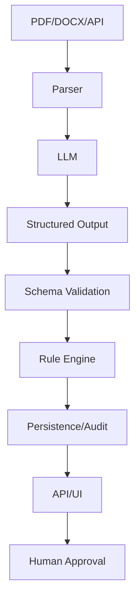

# Arquitetura

## Princípio

A arquitetura usa uma separação simples:

**probabilístico para compreender; determinístico para controlar.**

A LLM pode interpretar documentos e produzir um contrato estruturado. O motor Python recebe esse contrato e executa regras reproduzíveis.

## Componentes

### 1. Extração

Responsabilidade da camada de IA:
- localizar decisão;
- extrair datas e valores;
- classificar resultado;
- estruturar obrigação;
- sinalizar incerteza.

### 2. Contrato de dados

O JSON de entrada funciona como fronteira entre IA e código.

Benefícios:
- troca de provedor sem reescrever regras;
- testes sem chamar LLM;
- reprocessamento determinístico;
- auditoria do que foi efetivamente extraído.

### 3. Validação

Falha cedo em:
- datas impossíveis;
- valores negativos;
- combinações incoerentes;
- percentuais fora do limite do demo.

### 4. Motor de prazos

Recebe:
- intimação;
- data de análise;
- feriados opcionais;
- informação sobre ED.

Devolve prazo e status.

### 5. Motor financeiro

Usa `Decimal`.

Distingue:
- dano material exato;
- estimativa;
- honorários;
- outras verbas;
- compensação;
- exposição bruta.

### 6. Motor de roteamento

Regras sintéticas versionadas escolhem uma rota.

### 7. Auditoria

A saída inclui trilha textual das decisões do motor.

## Integração futura

## O que não está implementado

- fornecedor de LLM;
- OCR;
- RAG;
- banco de dados;
- API web;
- autenticação;
- calendário oficial.

A ausência é intencional na versão pública.
